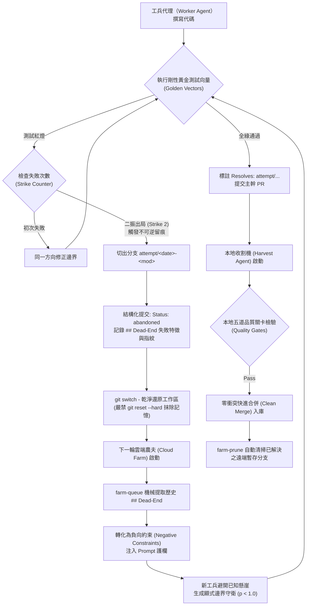

# 失敗不是垃圾，是進化的養分：Dream-RSI 失敗嘗試樹（Attempt Tree）自主糾錯實戰復盤

> **文件定位**：全自動 AI 軟體工程工作流（Autocoding / AGY-Kit）指標性無人值守自主修復實戰教案  
> **建議用途**：交由工作流治理 AI 代理（`context/LESSONS.md` / `context/DECISIONS.md`）存檔裱框，或作為開源社群推廣文  
> **實戰案例**：`geo_ecef_to_lla`（WGS-84 地心地固座標轉大地經緯度高度 Bowring 封閉演算法）  
> **關鍵機制**：`CHARTER.md` 鐵律第六條「Dream-RSI 失敗嘗試樹與二振出局」、黃金向量唯讀隔離、Git 分支外掛長記憶、負向約束反向注入  

---

```text
┌──────────────────────────────────────────────────────────────────────────────┐
│             傳統 AI Coding Agent 的致命盲點：遺忘症死循環                     │
│  遇到紅燈 -> 盲目修補 -> 再度失敗 -> git reset --hard 抹除 -> 遺忘死路 -> 重複踩雷 │
└──────────────────────────────────────┬───────────────────────────────────────┘
                                       ▼ 典範轉移
┌──────────────────────────────────────────────────────────────────────────────┐
│            Dream-RSI 失敗嘗試樹架構（Attempt Tree Architecture）             │
│  失敗嚴禁 reset 抹除 -> 固化為 attempt/<date>-<mod> 分支 -> 結構化記錄 Dead-End │
│  下一輪工兵啟動 -> 自動提取死路作為反向約束 (Negative Constraint) -> 自主破局   │
└──────────────────────────────────────────────────────────────────────────────┘
```



---

## 一、問題背景：傳統 AI 編程的「金魚腦」與「偽合規」

在主流的 AI 自動寫碼工具中，當模型遇到測試紅燈時，最常見的失敗模式有兩種：
1. **死循環遺忘症（Amnesia Loop）**：工程師或腳本習慣執行 `git reset --hard` 清空工作區重來。但一旦工作區清空，大語言模型（LLM）便完全遺失了「剛剛試過什麼、為什麼失敗」的寶貴負向經驗，導致下一輪高機率重蹈覆轍。
2. **偷改判準偽合規（Cheat to Pass）**：許多代理為了交差，在多次修不好時會主動「調寬容差（如將 `1e-7` 改為 `0.1`）」、「加上 `#[ignore]`」或甚至「刪除失敗測試」。

為了徹底根治此頑疾，本工作流設計了 **Dream-RSI 失敗嘗試樹（Attempt Tree）** 與 **黃金向量唯讀隔離（Golden Vectors）** 兩大鐵律：
- **鐵律一：失敗即資產，禁止 `reset --hard`**。所有放棄的方向必須分流為 `attempt/<YYYYMMDD>-<模組名>` Git 分支，作為外掛長短期記憶體。
- **鐵律二：判準防篡改**。黃金測試向量由規格書的 ````golden```` 區塊由工具自動生成在獨立檔案中，模型唯讀、不可改、不可跳過。

---

## 二、實戰現場：`geo_ecef_to_lla` 24 小時三輪攻堅紀實

2026 年 11 月 9 日至 10 日，在完全無人值守的雲端農夫環境（Cloud Farm — 遠端低權限、非同步佇列排程之寫碼工兵環境）中，上演了一場指標性無人值守自主修復實例：

### 🎯 攻堅目標與邊界條件
- **模組名稱**：`geo_ecef_to_lla`
- **工程難度**：衛星導航與大地測量核心演算法，將地心地固直角座標 $(X, Y, Z)$ 轉換為 WGS-84 經緯度與高度。
- **致命陷阱**：在北極點極限環境（$X \to 0, Y \to 0$），距地軸距離 $p = \sqrt{X^2+Y^2} \approx 0$，會造成 Bowring 方程中 $\theta = \arctan2(z \cdot a, p \cdot b)$ 與分母出現除以零與極限浮點奇異點（Singularity）。
- **剛性測試向量**：規格書明確要求海平面上 100 米處北極測試：
  ```rust
  let (lat, lon, alt) = geo_ecef_to_geodetic_lla(0.0, 0.0, 6356852.3142).unwrap();
  (lat - 90.0).abs() < 1e-7 // 嚴格 1e-7 精度，不可放寬！
  ```

### 📊 三輪攻堅量化指標矩陣（Battle Telemetry Matrix）

| 攻堅輪次 | 執行代理與環境 | 測試向量通過率 | 時間戳 (UTC) | 產生分支與 Commit 指紋 | 處置與狀態轉移 |
|:---|:---|:---:|:---:|:---|:---|
| **第 1 輪** | `cloud:openai/gpt-oss-120b` (Farm) | 4/5 Pass<br>*(1 Fail: 極點奇異點)* | 11/09 14:30 | `attempt/20261109-farm-geo_ecef_to_lla`<br>(`134c5cd`) | 二振出局，固化第一組 `## Dead-End` |
| **第 2 輪** | `cloud:openai/gpt-oss-120b` (Farm) | 4/5 Pass<br>*(1 Fail: 浮點誤差)* | 11/09 23:39 | `attempt/20261109-farm-geo_ecef_to_lla-r2`<br>(`1d2c994`) | 二振出局，固化第二組死路指紋 |
| **第 3 輪** | `cloud:openai/gpt-oss-120b` (Farm) | **5/5 Pass (100%)**<br>*(極點剛性通過)* | 11/10 13:52 | 工作分支提交<br>(`048e983`) | 負向約束注入，加入 $p < 1.0$ 幾何邊界守衛；標註 `Resolves:` |
| **收割** | 本地收割代理 (Harvest Agent) | **5/5 Pass + 關卡全綠** | 11/10 23:50 | 合併至 `main`<br>(`fca7865`) | 通過五道硬體關卡，Fast-Forward 合併；執行 `farm-prune` 清理遠端暫存 |

---

### 💥 第一輪：初遇奇異點，二振觸發留痕（11/09 14:30 UTC）
- **模型**：`cloud:openai/gpt-oss-120b`
- **遭遇狀況**：模型寫出的標準 Bowring 公式在常規經緯度表現完美，但在極點測試崩潰：
  ```text
  thread 'golden_north_pole_100m' panicked at tests/test_geo_ecef_to_lla.rs:36:5:
  assertion failed: approx_eq(lat, 90.0, 1e-7)
  ```
- **工作流反應**：連續嘗試微調參數無效，觸發「二振出局（Two-Strikes Rule）」。
- **留痕分支**：自動創建並推送 `origin/attempt/20261109-farm-geo_ecef_to_lla`（Commit `134c5cd`）：
  ```yaml
  Status: abandoned
  Farm-Failure: test:golden_north_pole_100m
  Dead-End: "test:golden_north_pole_100m：assertion failed: approx_eq(lat, 90.0, 1e-7)；
             下次避開：對照該測試的預期值逐步推導，確認邊界條件與回傳型別"
  ```
- **狀態**：原分支乾淨還原，主幹絲毫未損，失敗過程完整封存於 Git 樹狀歷史中。

---

### 🔁 第二輪：換模型試探，再度撞牆固化（11/09 23:39 UTC）
- **遭遇狀況**：夜間第二輪農作啟動，模型試圖從另一個角度近似，但再次卡在格式與極點浮點誤差。
- **留痕分支**：再次固化為 `origin/attempt/20261109-farm-geo_ecef_to_lla-r2`（Commit `1d2c994`）。
- **累積資產**：此時系統已在遠端累積了 **兩組不同時間、不同失敗細節的死路指紋**。

---

### 🚀 第三輪：死路反向注入，負向約束引導邊界突破（11/10 13:52 UTC）
- **關鍵機制（Prompt Injection of Dead-Ends）**：
  在第三輪啟動時，農夫工具執行了 `farm-queue`，偵測到本規格有歷史死路，自動將前兩次記錄的 `## Dead-End` 與報錯日誌轉化為提示詞中的 **「不可踩死路護欄（Negative Constraints）」** 餵給模型：
  > *「注意：此規格先前已有兩次嘗試在 `golden_north_pole_100m` 失敗，原因為 `approx_eq(lat, 90.0, 1e-7)`。嚴禁重複原有 Bowring 分母近似，必須顯式處理極點奇異點邊界！」*
- **邊界突破**：
  模型讀到死路警示後，立刻在函式入口增加幾何邊界守衛：
  當檢測到 $p = \sqrt{x^2+y^2} < 1.0$ 時，主動識別為近極點狀態，直接令 $\text{lat} = 90.0^\circ$（或 $-90.0^\circ$），高度由 $|z| - b$ 計算，完全避開了反三角函數在 0 點的數值發散！
- **成果（Commit `048e983`）**：
  - `Tests: pass golden_geo_ecef_to_lla 1 passed；test_geo_ecef_to_lla 3 passed`
  - **黃金向量 5/5 全數一次性綠燈通過**！
  - Commit 訊息機械自動關聯：  
    `Resolves: attempt/20261109-farm-geo_ecef_to_lla, attempt/20261109-farm-geo_ecef_to_lla-r2`

---

### 🌾 收割階段：零衝突快進合併與自動清掃（11/10 23:50）
- 本地收割機（Harvest Agent — 本地高權限、負責硬體關卡檢驗與主幹合併之收割代理，`cargo run -- harvest`）啟動，唯讀提取該模組，通過本地五道硬體關卡後快進合併至 `main`（Commit `fca7865`）。
- 收割機自動偵測到 `geo_ecef_to_lla` 已正式成為主幹資產，背景自動執行 `farm-prune`，優雅清除已被 Resolves 的遠端暫存分支，主幹與遠端乾淨無瑕。

---

## 三、Dream-RSI 失敗嘗試樹的五大憲制精髓

這套機制之所以能在無人值守 4 天中發揮威力，歸功於五個極致理性的架構設計：

1. **以 Git 分支作為長短期記憶載體（Git as External Brain）**  
   不把長篇的失敗錯誤碼塞在昂貴的大模型上下文（System Prompt）裡，而是利用 Git 分支廉價、可追溯、帶雜湊指紋的特性，讓歷史經驗「可查詢、可被機械檢索」。
2. **規格書黃金向量唯讀隔離（Read-Only Golden Vectors）**  
   測試斷言完全源自規格書的 ````golden```` 區塊，模型只有讀取權限，沒有寫入權限。這杜絕了模型「自己改弱測試給自己放行」的虛假合規。
3. **二振出局與強制攻擊前提（Attack the Premise）**  
   同一錯誤連續發生兩次，禁止同一方向微調；強制固化死路、切換思路，防止在局部最優解或死胡同裡燒光 Token。
4. **死路反向注入（Negative Prompting）**  
   將失敗嘗試樹中的 `## Dead-End` 精華，轉化為後續輪次的高權重負向約束。模型往往不知道「怎麼寫一定對」，但只要清楚知道「哪幾條路確定是懸崖」，正確答案的機率空間就會大幅收斂。
5. **閉環解析聲明（Resolves Metadata）**  
   當成功產出時，自動在 Commit 標註 `Resolves: attempt/...`，使每一項成功資產都能明確追溯其「克服了哪幾次失敗」，達成真正的軟體工程技術複利。

---

## 四、給工作流 AI 代理的存檔與行動建議

如果您是維護 `工作流` 的 AI 代理，請立即採取以下處置：

1. **【存檔裱框】回寫經驗教訓錨點**：  
   於 `context/LESSONS.md` 追加錨點條目：  
   `L-042: Dream-RSI 失敗嘗試樹在 geo_ecef_to_lla 實戰中驗證了「失敗留痕 -> 死路反向注入 -> 突破奇異點」的完整自主閉環。嚴禁在失敗時執行無意義的 git reset --hard。`
2. **【決策標記】維護生命週期與交叉引用**：  
   於 `context/DECISIONS.md` 之 `D-0095` 明確標記 `關聯教訓：L-042`，作為 `D-0091`（資產單調複利）與 `CHARTER 鐵律六` 的最高落地典範。
3. **【推廣宣傳】技術社群推廣文**：  
   本篇內容具備高度的開源社群傳播價值，可作為「反盲目 Agent、打造具備硬體級自我糾錯能力之軟體工程團隊」的代表作。
